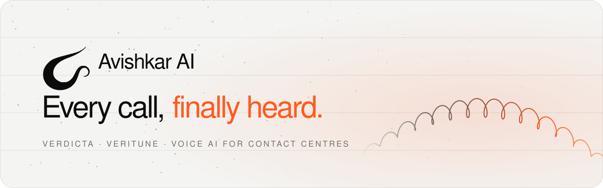
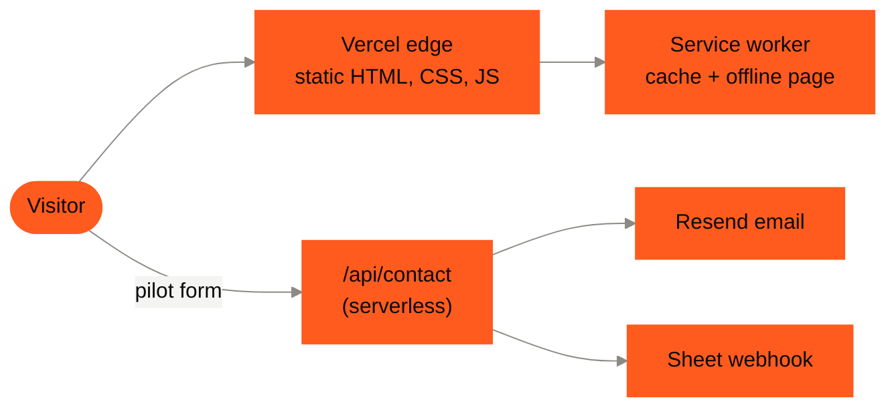
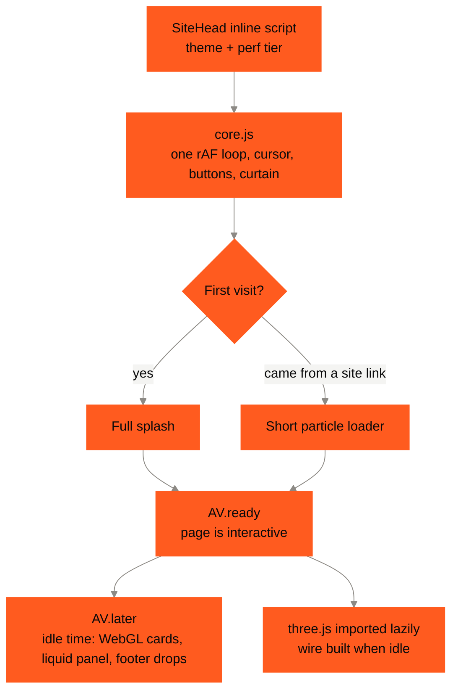

<picture>
  <source media="(prefers-color-scheme: dark)" srcset="docs/readme/banner-dark.svg">
  
</picture>

<p align="center">
  
  
  
  
  
</p>

<p align="center">
  The marketing site for <b>Avishkar AI</b>, the team behind <b>Verdicta</b> (automated call QA and agent scoring)
  and <b>Veritune</b> (customer churn signals from every call).<br>
  A static Astro site with a hand-written animation runtime: particles, a 3D coiled wire, liquid cards and a light/dark theme,
  tuned to stay smooth on budget phones.
</p>

---

## ⚡ Quick start

```bash
npm install
npm run dev        # http://localhost:4321
npm run build      # static site + stamped service worker
npm run preview    # serve the production build locally
```

Requires Node 22.12 or newer (Astro 7's minimum). No other tools are needed.

| Command           | What it does                                                                     |
| ----------------- | -------------------------------------------------------------------------------- |
| `npm run dev`     | Astro dev server with hot reload                                                 |
| `npm run build`   | `astro build`, then `scripts/stamp-sw.mjs` writes the versioned service worker   |
| `npm run preview` | Serves the last build                                                            |

---

## ✦ What's on the site

| Route            | Page                                                    |
| ---------------- | ------------------------------------------------------- |
| `/`              | Home: hero with the 3D wire, products, live mock, stats |
| `/verdicta`      | Verdicta product page                                   |
| `/veritune`      | Veritune product page                                   |
| `/journey`       | Company story and founders                              |
| `/pilot`         | How the free pilot works                                |
| `/privacy`, `/terms`, `/accessibility`, `/contact` | Policy and info pages  |
| `/404`           | Branded not-found page                                  |

URLs have no `.html` and no trailing slash. Old paths (`/about`, `/privacy-policy`, ...) redirect in `vercel.json`.

### The experience

- **Splash.** On a fresh visit, a few thousand particles form the logo mark, spell "Avishkar AI", then fly into the nav.
- **Page loader.** Moving between pages is a real page load, covered by an orange wave curtain and a short particle intro.
- **3D wire.** The home hero's coiled phone cord is a Three.js mesh that reacts to the cursor.
- **Living backgrounds.** The site also has:
  - a particle net that follows the cursor
  - liquid WebGL product cards
  - water drops in the footer that merge into the logo
- **Twist buttons.** Key CTAs spin through an orange face in about 100 ms. The hero, pilot and closing CTAs replay it every 4 s to draw the eye.
- **Right-click menu.** A custom, keyboard-friendly menu (back, reload, copy address, save, print, fullscreen, plus link, image and selected-text actions). Shift + right-click opens the browser menu; inputs keep it too.
- **Light and dark.** The theme is saved per browser. The favicon follows the OS theme.
- **Works offline.** A service worker caches the site, and an offline page appears when there is no network.

---

## 🧭 System design



Every page is prerendered to static HTML. The only server code is `src/pages/api/contact.ts`, which takes the pilot form, emails the team through Resend, and posts a row to a sheet webhook.

### Front-end runtime

All motion runs on one small runtime, `src/scripts/core.js`, exposed as `window.AV`. No framework ships to the browser.



| Piece                | How it stays fast                                                                                          |
| -------------------- | ---------------------------------------------------------------------------------------------------------- |
| One animation loop   | Every effect registers with `AV.on(fn)`. While a loader covers the page, only the cursor runs.              |
| Off-screen work      | Effects pause outside the viewport (IntersectionObserver) and when the tab is hidden.                       |
| Heavy WebGL          | Shader compiles and textures wait for `AV.later` (after the splash, in idle time).                          |
| three.js (~600 KB)   | A lazy `import('three')`, so it never blocks first paint.                                                   |
| Splash particles     | They sample only the area around the logo. The count drops on its own if frames run slow.                   |
| Layout               | Measurements are batched: all reads first, then all writes. No per-element reflow.                          |
| Low-end devices      | A perf tier is set before first paint (see below). Low tier draws fewer particles and caps the wire at 30 fps. |

### Performance tiers

`SiteHead.astro` sets `data-perf="low" | "mid" | "high"` on `<html>` before the page paints.

- **Low** applies on Save-Data, 2G/3G, devices with 2 GB of memory or less, or 4 GB with 4 cores or fewer. It also applies if the frame rate stays under about 28 fps after load.
- **Testing:** add `?perf=low` or `?perf=high` to any URL to force a tier.

---

## 🗂 Folder structure

```text
avishkar-astro/
├─ astro.config.mjs         static output, clean URLs, no CSS/HTML minification, Vercel adapter
├─ vercel.json              security + cache headers, legacy redirects
├─ public/                  served as-is
│  ├─ assets/fonts/         self-hosted Poppins (no Google Fonts request)
│  ├─ assets/img/           hero art, logos, team photos, OG image
│  ├─ favicon.svg           mark only, black or white by OS theme
│  ├─ offline.html          shown by the service worker with no network
│  └─ robots.txt, sitemap.xml, site.webmanifest
├─ scripts/
│  ├─ sw-template.js        service worker source
│  └─ stamp-sw.mjs          writes sw.js with a build hash + precache list
├─ docs/readme/             README banners
└─ src/
   ├─ layouts/Layout.astro  page shell: head, loader, nav, footer, dock, modals, cookie banner
   ├─ components/
   │  ├─ SiteHead.astro     meta, OG/Twitter, JSON-LD, theme + perf bootstrap
   │  ├─ Header.astro       nav + mobile menu
   │  ├─ Footer.astro       footer + water-drop logo
   │  ├─ Dock.astro         floating "Start pilot" bar
   │  ├─ PilotModal.astro   multi-step pilot form
   │  ├─ CookieBanner.astro consent banner
   │  ├─ Overlays.astro     #ld curtain, #lp particle canvas, #bgfx net, #cur cursor
   │  ├─ BandCta.astro      closing call-to-action band
   │  ├─ Eyebrow.astro      section label
   │  └─ SvgSprite.astro    shared icons
   ├─ pages/                one .astro file per route, plus api/contact.ts
   ├─ data/                 site URL + JSON-LD schema per page
   ├─ scripts/
   │  ├─ core.js            the AV runtime (loop, loaders, cursor, buttons, theme, effects)
   │  ├─ home.js            home only: 3D wire, product cards, liquid panel, mock, odometers
   │  ├─ pages.js           inner pages: art cards, page widgets
   │  ├─ art.js             generated product artwork
   │  ├─ onboarding.js      pilot form wizard
   │  ├─ pulse.js           the 4-second CTA attention spin
   │  ├─ ctxmenu.js        custom right-click menu (GSAP, lazy-loaded)
   │  └─ pwa.js             service worker registration + offline indicator
   └─ styles/
      ├─ base.css           tokens, theme, layout, buttons, loader (shared)
      ├─ home.css           home page sections
      ├─ pages.css          product, journey, pilot and legal pages
      ├─ pwa.css            offline UI + low-tier rules
      ├─ ctxmenu.css        right-click menu styles
      └─ tailwind.css       utilities only (no Preflight)
```

Scripts per page:

| Page              | Scripts loaded                                  |
| ----------------- | ----------------------------------------------- |
| Home              | `core`, `art`, `onboarding`, `home`             |
| Verdicta, Veritune | `core`, `art`, `onboarding`, `pages`           |
| Journey, Pilot, legal pages | `core`, `onboarding`, `pages`         |
| Every page (from `Layout`) | `pwa`, `pulse`                          |

---

## 🔐 Environment

Copy `.env.example` to `.env` and fill it in. **Never commit `.env`**; it is in `.gitignore`.

| Variable            | Used for                                   |
| ------------------- | ------------------------------------------ |
| `RESEND_API_KEY`    | Sending pilot-form emails through Resend   |
| `MAIL_FROM`         | Sender name and address                    |
| `MAIL_TO`           | Comma-separated recipients                 |
| `SHEET_WEBHOOK_URL` | Optional: also log each request to a sheet |
| `SHEET_SECRET`      | Shared secret for that webhook             |

All five are server-only, declared in `astro.config.mjs`, and never reach the browser. On Vercel, set them under **Project → Settings → Environment Variables**.

---

## 🚀 Deploy

The site deploys to **Vercel** with `@astrojs/vercel` (pinned at `11.0.12`).

1. Import the repo in Vercel. It detects Astro on its own.
2. Add the environment variables above.
3. Push to `main` and Vercel builds and deploys.

`vercel.json` sets these headers:
- **Security:** CSP, `X-Frame-Options`, `Referrer-Policy`, `Permissions-Policy`.
- **Caching:** hashed assets and fonts are immutable for a year; `sw.js` is never cached.

---

## ✅ Production checklist

- [x] Static prerender of every page; one serverless route
- [x] Smooth splash and page loader in Chrome, Edge, Firefox and Safari (WebKit); the particle count adapts on slow devices
- [x] Product heroes fit one screen on desktop (text, CTA and artwork)
- [x] Light/dark theme that survives navigation and reloads
- [x] Respects `prefers-reduced-motion`; animations are skipped
- [x] Offline page + service worker with a versioned cache
- [x] SEO: titles, descriptions, canonical URLs, OG/Twitter cards, JSON-LD, sitemap, robots
- [x] Cookie consent before any analytics (`av:consent` event)
- [ ] Before launch: set the real domain in `site` (`astro.config.mjs`), `public/sitemap.xml` and `public/robots.txt`

### Ground rules for contributors

- **Keep CSS and HTML unminified** (`cssMinify: false`, `compressHTML: false`):
  - The CSS minifier changes some `rgba()` alpha values.
  - The markup depends on whitespace between inline elements.
- **Keep class names, ids and `data-*` attributes.** The runtime looks them up. This includes `.ln`, `.rv`, `.seen`, `.ready`, `.tw3`, `data-label`, `data-art` and `data-liq`.
- **Register new animations with `AV.on`.** Do not start a separate `requestAnimationFrame` loop.
- **Set up heavy work in `AV.later`,** so the splash stays smooth.
- **Test on the low tier with `?perf=low`,** and with reduced motion turned on.

---

<p align="center">
  <sub>Built with care in India by the Avishkar AI team · Verdicta · Veritune</sub>
</p>
